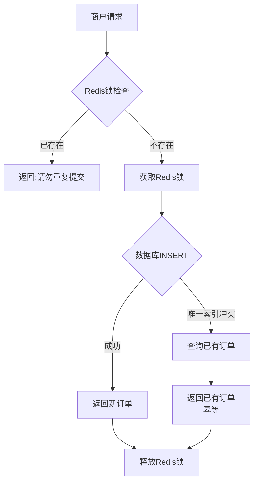
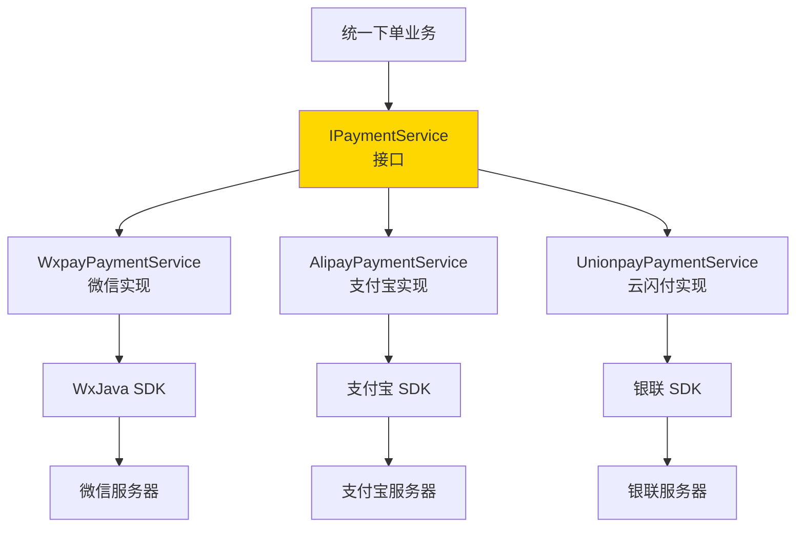
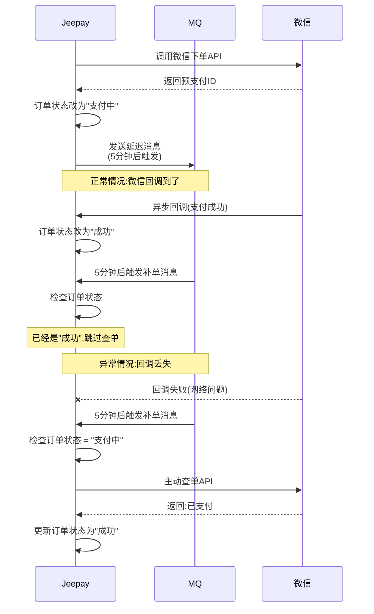
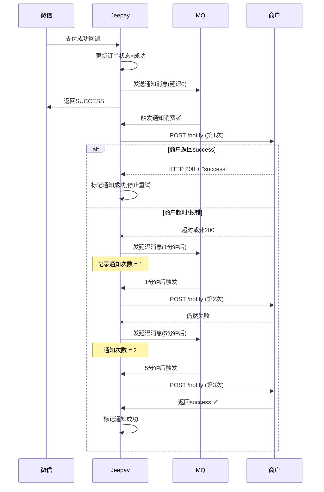
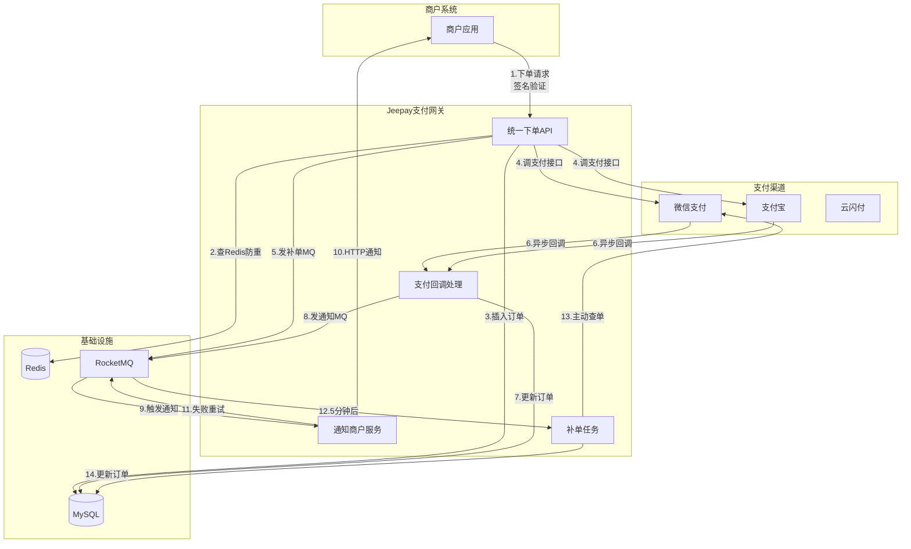
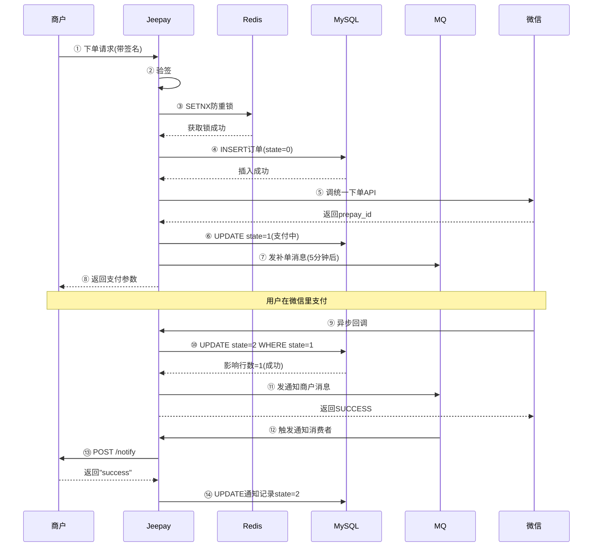
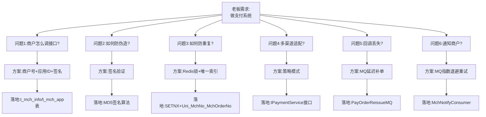
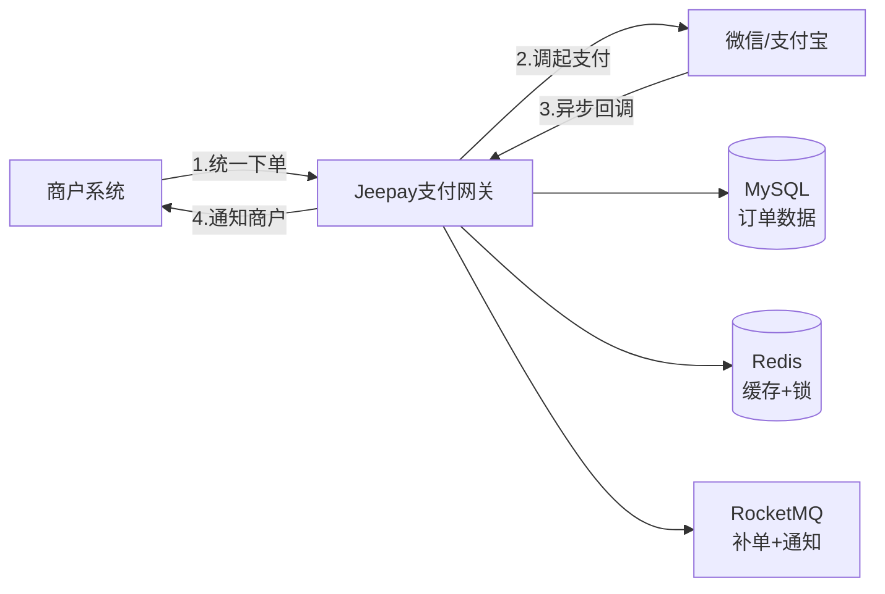
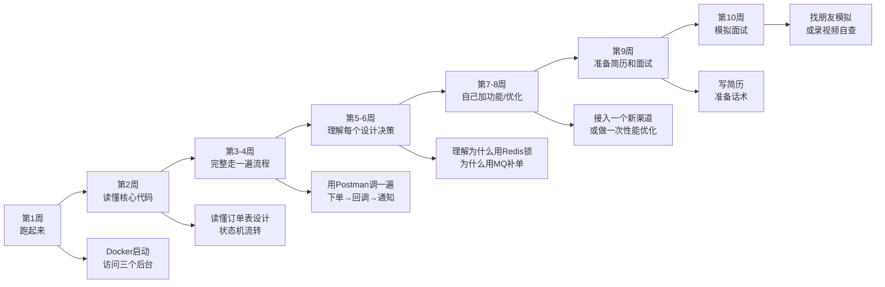

> **目标读者**: 有 CRUD/HTTP/Redis/MQ 使用经验,但不知道"为什么这么设计"的后端开发者
>
> **核心理念**: 不讲技术黑话,从真实需求出发,一步步推导出最终方案

---

github:https://github.com/jeequan/jeepay

## 开篇:如果是你,会怎么做?

**场景**: 老板找到你说:"我们公司要做一个支付系统,让其他商户接入我们,我们帮他们对接微信支付、支付宝。"

你会怎么做?先别往下看,想想会遇到什么问题。

---

## 第一章:需求分析 - 拆解真实问题

### 1.1 核心需求

**老板的原话**: "做一个支付系统"

**翻译成技术需求**:

1. 商户能通过我们的接口发起支付
2. 我们调用微信/支付宝的接口
3. 用户支付成功后,我们通知商户

**看起来很简单?** 我们一层层拆解,看看会遇到什么坑。

---

## 第二章:问题推演 - 一个订单的完整生命周期

{/* 后续章节占位 */}

### 2.1 问题1:商户怎么调用我们的接口?

**场景还原**:

- 用户在商户网站(比如某个卖课程的网站)点击"购买课程 ¥99"
- 商户需要调用你的支付系统发起支付

**你的第一反应可能是**: "简单啊,提供一个 HTTP 接口,商户 POST 过来订单信息就行"

```http
POST /api/pay/order
{
  "orderId": "ORDER123",
  "amount": 9900,  // 单位:分
  "subject": "Python课程"
}
```

**但马上遇到第一个问题**: 你怎么知道这个请求是哪个商户发的?

#### 方案对比

| 方案 | 做法 | 优点 | 缺点 | 结论 |
|-|-|-|-|-|
| 方案1: 不区分 | 谁都能调 | 简单 | ❌ 无法知道钱该打给谁 | 不可行 |
| 方案2: IP白名单 | 只允许特定IP | 安全 | ❌ 商户换服务器就要重新配置 | 不灵活 |
| 方案3: 商户ID | 参数里带 `mchNo` | 能区分商户 | ❌ 别人也可以伪造 mchNo | 不安全 |
| **方案4: 商户ID + 密钥** | `mchNo` + `appSecret` 签名 | ✅ 既能区分又防伪造 | 需要商户学会签名算法 | **最终选择** |

#### Jeepay 的方案

**接口设计**:

```http
POST /api/pay/unifiedOrder
{
  "mchNo": "M1001",           // 商户号(公开,区分身份)
  "appId": "APP_20240810",    // 应用ID(一个商户可以有多个应用)
  "mchOrderNo": "ORDER123",   // 商户自己的订单号
  "amount": 9900,
  "subject": "Python课程",
  "sign": "A1B2C3D4..."       // 签名(防伪造)
}
```

**为什么要 appId?**

- 生活类比: 你开了个淘宝店(商户),但有两个业务:卖课程 + 卖书
- 两个业务用不同的收款账号、通知地址
- 所以一个商户(mchNo)可以有多个应用(appId)

**落地到数据库**:

```sql
-- 商户表
CREATE TABLE t_mch_info (
  mch_no VARCHAR(64) PRIMARY KEY,  -- 商户号
  mch_name VARCHAR(100)             -- 商户名称
);

-- 应用表
CREATE TABLE t_mch_app (
  app_id VARCHAR(64) PRIMARY KEY,   -- 应用ID
  mch_no VARCHAR(64),               -- 属于哪个商户
  app_secret VARCHAR(128),          -- 密钥(用于签名验证)
  notify_url VARCHAR(512),          -- 支付成功后通知这个地址
  FOREIGN KEY (mch_no) REFERENCES t_mch_info(mch_no)
);
```

**为什么要两张表,不能合并?**

- 如果合并: 一个商户想要2个应用,就要创建2个商户,商户号重复了
- 分开后: 一个商户记录,下面挂多个应用记录

### 2.2 问题2:如何防止恶意请求?

**场景还原**:

- 黑客抓包看到商户的请求:

```json
{
  "mchNo": "M1001",
  "amount": 9900,
  "subject": "Python课程"
}
```

- 黑客把 `amount` 改成 `1` (1分钱),重放这个请求
- 如果你不验证,黑客就能1分钱买课程

#### 解决方案:签名机制

**核心思想**: 加一个只有商户知道的密钥,生成一个"指纹"

**生活类比**:

- 你写了封信(请求参数)
- 信封上盖了你的私章(签名)
- 别人可以看到信的内容,但伪造不了私章
- 收信人验证私章,确认是你发的且内容没被篡改

#### 签名算法推导

**第一步**: 商户有一个密钥 `appSecret = "ABC123"`(创建应用时生成,只有商户知道)

**第二步**: 把所有参数按key排序,拼接成字符串:

```
amount=9900&mchNo=M1001&mchOrderNo=ORDER123&subject=Python课程
```

**第三步**: 拼上密钥:

```
amount=9900&mchNo=M1001&mchOrderNo=ORDER123&subject=Python课程&key=ABC123
```

**第四步**: 计算 MD5(转大写):

```
sign = MD5("amount=9900&mchNo=M1001&mchOrderNo=ORDER123&subject=Python课程&key=ABC123")
     = "5E8A9F2B3C1D..."
```

**第五步**: 商户把 `sign` 也放到请求里:

```json
{
  "mchNo": "M1001",
  "amount": 9900,
  "mchOrderNo": "ORDER123",
  "subject": "Python课程",
  "sign": "5E8A9F2B3C1D..."
}
```

**你的服务端验证**:

1. 收到请求后,从数据库查出这个商户的 `appSecret`
2. 用同样的算法计算一遍签名
3. 对比商户传来的 `sign` 和你算出来的 `sign`
4. 一致 → 通过;不一致 → 拒绝

**黑客为什么伪造不了?**

- 黑客改了 `amount=1`,但他不知道 `appSecret`
- 他算不出正确的 `sign`
- 你验签时发现不匹配,拒绝请求

#### Jeepay 代码实现

```java
// 验签逻辑 (UnifiedOrderController.java)
public boolean verifySign(Map<String, String> params, String appSecret) {
    String signFromClient = params.get("sign");  // 商户传来的签名
    params.remove("sign");  // 计算时要去掉sign字段

    // 1. 参数排序
    TreeMap<String, String> sortedParams = new TreeMap<>(params);

    // 2. 拼接: key1=value1&key2=value2...&key=appSecret
    String str = sortedParams.entrySet().stream()
        .map(e -> e.getKey() + "=" + e.getValue())
        .collect(Collectors.joining("&"));
    str += "&key=" + appSecret;

    // 3. MD5大写
    String signCalculated = DigestUtils.md5Hex(str).toUpperCase();

    // 4. 对比
    return signCalculated.equals(signFromClient);
}
```

**为什么要排序?**

- 商户可能传 `{a:1, b:2}`,也可能传 `{b:2, a:1}`
- JSON对象是无序的,但签名字符串必须有序
- 双方约定:按key字典序排序,保证算出的签名一致

### 2.3 问题3:如何防止重复下单?

**场景还原**:

- 用户点击"支付"按钮
- 网络卡顿,页面没反应
- 用户又点了2次
- 结果:生成了3笔订单,用户支付了3次!

#### 方案推导

**方案1: 前端防抖(按钮点击后禁用)**

```javascript
button.onclick = function() {
  button.disabled = true;  // 禁用按钮
  callPayAPI();
}
```

**问题**:

- ❌ 用户刷新页面,按钮又能点了
- ❌ 用户用 Postman 直接调接口,绕过前端
- ❌ 前端代码可以被篡改

**结论**: 前端防抖是体验优化,不能作为防重的唯一手段

---

**方案2: 后端内存去重(用 HashMap)**

```java
// 用个 Map 记录已处理的订单号
private static Map<String, Boolean> processedOrders = new HashMap<>();

public void createOrder(String mchOrderNo) {
    if (processedOrders.containsKey(mchOrderNo)) {
        return "订单已存在";  // 防重
    }
    processedOrders.put(mchOrderNo, true);
    // 创建订单...
}
```

**问题**:

- ❌ 服务重启后 Map 清空,防重失效
- ❌ 多台服务器,每台有自己的 Map,不共享
- ❌ 内存会越来越大(订单号越积越多)

**结论**: 单机内存不可靠

---

**方案3: Redis 分布式锁**

```java
public void createOrder(String mchOrderNo) {
    String lockKey = "order_lock:" + mchOrderNo;

    // 尝试获取锁,30秒超时
    Boolean locked = redisTemplate.opsForValue()
        .setIfAbsent(lockKey, "1", 30, TimeUnit.SECONDS);

    if (!locked) {
        return "订单处理中,请勿重复提交";
    }

    try {
        // 创建订单...
    } finally {
        redisTemplate.delete(lockKey);  // 释放锁
    }
}
```

**优点**: ✅ 多台服务器共享,重启不丢失

**问题**:

- ⚠️ 如果 Redis 挂了,整个支付系统不可用
- ⚠️ 锁30秒后自动过期,如果业务执行超过30秒,可能重复执行

**结论**: 可以用,但不能作为唯一防线

---

**方案4: 数据库唯一索引(最终防线)**

```sql
CREATE TABLE t_pay_order (
  pay_order_id VARCHAR(30) PRIMARY KEY,      -- Jeepay生成的订单号
  mch_no VARCHAR(64),                         -- 商户号
  mch_order_no VARCHAR(64),                   -- 商户订单号
  amount BIGINT,

  -- 关键:唯一索引
  UNIQUE KEY `Uni_MchNo_MchOrderNo` (`mch_no`, `mch_order_no`)
);
```

**原理**:

- 商户用同一个 `mchOrderNo` 提交第2次
- 数据库 INSERT 时报错:`Duplicate entry 'M1001-ORDER123'`
- 你捕获这个错误,返回:"订单已存在"

**为什么是 `(mch_no, mch_order_no)` 组合?**

- 商户A的 `ORDER123` 和商户B的 `ORDER123` 不冲突
- 必须同一商户的同一订单号才算重复

**代码实现**:

```java
public ApiRes createOrder(UnifiedOrderReqDTO req) {
    try {
        // 尝试插入订单
        PayOrder order = new PayOrder();
        order.setPayOrderId(generateOrderId());  // Jeepay生成
        order.setMchNo(req.getMchNo());
        order.setMchOrderNo(req.getMchOrderNo());  // 商户传的
        order.setAmount(req.getAmount());

        payOrderMapper.insert(order);  // 如果重复会抛异常

        return ApiRes.success(order);

    } catch (DuplicateKeyException e) {
        // 捕获唯一索引冲突
        // 查出已存在的订单,返回给商户(幂等)
        PayOrder existOrder = payOrderMapper.selectOne(
            new LambdaQueryWrapper<PayOrder>()
                .eq(PayOrder::getMchNo, req.getMchNo())
                .eq(PayOrder::getMchOrderNo, req.getMchOrderNo())
        );
        return ApiRes.success(existOrder);
    }
}
```

**为什么返回已存在的订单,而不是报错?**

- 商户可能真的是网络超时重试
- 返回原订单信息,商户可以继续用这个订单支付
- 这叫**幂等**:同一个请求执行多次,结果和执行一次一样

---

#### Jeepay 的最终方案:多层防御



**为什么要两层?**

- Redis锁:**前置拦截**,挡住99%的重复请求,减轻数据库压力
- 唯一索引:**兜底保障**,即使Redis挂了,数据库也能保证不重复

**Trade-off(取舍)**:

- 牺牲:多一次Redis调用,延迟增加几毫秒
- 收益:防止了重复下单,避免用户重复扣款

### 2.4 问题4:微信/支付宝接口不同怎么办?

**场景还原**:

- 你对接了微信支付,写了一堆代码
- 老板说:再对接支付宝
- 你发现:微信和支付宝的接口完全不一样!

#### 微信 vs 支付宝的差异

| 维度 | 微信支付 | 支付宝 |
|-|-|-|
| 接口地址 | `https://api.mch.weixin.qq.com/v3/pay/transactions/jsapi` | `https://openapi.alipay.com/gateway.do` |
| 签名算法 | RSA-SHA256(V3) 或 MD5(V2) | RSA2 |
| 参数格式 | JSON | 表单(key=value&key=value) |
| 字段名 | `out_trade_no`(下划线) | `out_trade_no`(下划线) |
| 金额单位 | **分**(100 = 1元) | **元**(1.00 = 1元) |
| 回调通知 | POST 加密JSON | POST 表单 |

**如果不抽象,代码会变成这样**:

```java
public void pay(PayOrderDTO order) {
    if (order.getPayChannel().equals("wxpay")) {
        // 微信支付逻辑
        WxPayUnifiedOrderRequest wxReq = new WxPayUnifiedOrderRequest();
        wxReq.setOutTradeNo(order.getOrderId());
        wxReq.setTotalFee(order.getAmount());  // 单位:分
        wxReq.setBody(order.getSubject());
        // ... 还有20个字段

        WxPayService wxPayService = new WxPayServiceImpl();
        wxPayService.setConfig(wxConfig);
        WxPayUnifiedOrderResult result = wxPayService.unifiedOrder(wxReq);

    } else if (order.getPayChannel().equals("alipay")) {
        // 支付宝支付逻辑
        AlipayTradeCreateRequest alipayReq = new AlipayTradeCreateRequest();
        alipayReq.setOutTradeNo(order.getOrderId());
        alipayReq.setTotalAmount(order.getAmount() / 100.0);  // 单位:元,要除以100!
        alipayReq.setSubject(order.getSubject());
        // ... 又是一堆不同的字段

        AlipayClient alipayClient = new DefaultAlipayClient(...);
        AlipayTradeCreateResponse response = alipayClient.execute(alipayReq);

    } else if (order.getPayChannel().equals("unionpay")) {
        // 云闪付又是另一套逻辑...
    }
    // 以后每加一个渠道,这里就多一个 else if,越来越臃肿
}
```

**问题**:

- ❌ 每加一个渠道,这个方法越来越长
- ❌ 微信/支付宝的代码混在一起,难以维护
- ❌ 测试时无法单独测试某个渠道

#### 解决方案:策略模式 + 抽象接口

**核心思想**: 定义统一的接口,每个渠道一个实现类

**第一步:定义抽象接口**

```java
// IPaymentService.java - 支付服务接口
public interface IPaymentService {

    /**
     * 统一下单
     * @param payOrder Jeepay的订单对象(统一格式)
     * @return 渠道返回结果
     */
    ChannelRetMsg pay(PayOrder payOrder, JSONObject channelExtra);

    /**
     * 查询订单
     */
    ChannelRetMsg query(PayOrder payOrder);

    /**
     * 关闭订单
     */
    ChannelRetMsg close(PayOrder payOrder);
}
```

**第二步:每个渠道实现这个接口**

```java
// WxpayPaymentService.java - 微信支付实现
@Service("wxpayPaymentService")
public class WxpayPaymentService implements IPaymentService {

    @Override
    public ChannelRetMsg pay(PayOrder payOrder, JSONObject channelExtra) {
        // 1. 把 Jeepay 的 PayOrder 转成微信的格式
        WxPayUnifiedOrderRequest wxReq = new WxPayUnifiedOrderRequest();
        wxReq.setOutTradeNo(payOrder.getPayOrderId());
        wxReq.setTotalFee(payOrder.getAmount().intValue());  // 已经是分
        wxReq.setBody(payOrder.getSubject());

        // 2. 调用微信API
        WxPayService wxPayService = getWxPayService(payOrder);
        WxPayUnifiedOrderResult wxResult = wxPayService.unifiedOrder(wxReq);

        // 3. 把微信的返回转成 Jeepay 的统一格式
        ChannelRetMsg retMsg = new ChannelRetMsg();
        retMsg.setChannelState(ChannelState.CONFIRM_SUCCESS);
        retMsg.setChannelOrderId(wxResult.getPrepayId());
        return retMsg;
    }
}
```

```java
// AlipayPaymentService.java - 支付宝实现
@Service("alipayPaymentService")
public class AlipayPaymentService implements IPaymentService {

    @Override
    public ChannelRetMsg pay(PayOrder payOrder, JSONObject channelExtra) {
        // 1. 转成支付宝格式
        AlipayTradeCreateRequest alipayReq = new AlipayTradeCreateRequest();
        alipayReq.setOutTradeNo(payOrder.getPayOrderId());
        // 注意:支付宝要元,要除以100
        alipayReq.setTotalAmount(payOrder.getAmount().divide(new BigDecimal(100)).toString());
        alipayReq.setSubject(payOrder.getSubject());

        // 2. 调用支付宝API
        AlipayClient alipayClient = getAlipayClient(payOrder);
        AlipayTradeCreateResponse alipayResp = alipayClient.execute(alipayReq);

        // 3. 转成统一格式
        ChannelRetMsg retMsg = new ChannelRetMsg();
        retMsg.setChannelState(ChannelState.CONFIRM_SUCCESS);
        retMsg.setChannelOrderId(alipayResp.getTradeNo());
        return retMsg;
    }
}
```

**第三步:业务代码只依赖接口**

```java
// UnifiedOrderService.java - 统一下单服务
public ChannelRetMsg unifiedOrder(PayOrder payOrder) {
    // 根据 ifCode(接口代码) 获取对应的实现类
    String ifCode = payOrder.getIfCode();  // "wxpay" 或 "alipay"

    // Spring 自动注入对应的实现类
    IPaymentService paymentService = SpringUtil.getBean(ifCode + "PaymentService");

    // 调用统一接口,不关心底层是微信还是支付宝
    return paymentService.pay(payOrder, channelExtra);
}
```

**现在加新渠道只需要**:

1. 新建一个类 `UnionpayPaymentService implements IPaymentService`
2. 实现 `pay()` / `query()` / `close()` 三个方法
3. 业务代码完全不用改!

---

#### 架构图



**这就是设计模式中的"策略模式"**:

- 定义统一接口(策略)
- 多个实现类(不同策略)
- 运行时动态选择(根据 ifCode)

**为什么不用 if-else?**

| if-else | 策略模式 |
|-|-|
| 所有逻辑写在一个类里 | 每个渠道独立一个类 |
| 加新渠道要改原代码 | 加新渠道只需新建类 |
| 难以单元测试 | 可以单独测试每个实现类 |
| 违反"开闭原则" | ✅ 对扩展开放,对修改关闭 |

### 2.5 问题5:支付回调可能丢失怎么办?

**场景还原**:

1. 用户在微信里输入密码,支付成功
2. 微信发送回调通知给你:`POST /api/pay/notify/wxpay/P12345`
3. **但是**...你的服务器正好在重启/网络抖动/机房断电
4. 回调没收到!
5. 你的订单一直是"支付中"状态
6. 用户投诉:"我明明付了钱,为什么订单还是待支付?"

#### 天真的想法

**你可能想**: "让微信多发几次回调就行"

**现实**:

- 微信确实会重试,但只重试 **15分钟内最多8次**
- 如果这15分钟你的服务都挂着,回调还是丢了
- 微信不会无限重试(否则他们服务器也扛不住)

**所以不能完全依赖微信主动推送,你要有主动拉取的能力!**

---

#### 方案推导

**方案1: 定时扫描数据库**

```java
// 每分钟扫描一次"支付中"的订单
@Scheduled(cron = "0 * * * * ?")
public void checkPendingOrders() {
    // 查询状态=支付中,且创建超过5分钟的订单
    List<PayOrder> orders = payOrderMapper.selectList(
        new LambdaQueryWrapper<PayOrder>()
            .eq(PayOrder::getState, STATE_ING)
            .lt(PayOrder::getCreatedAt, 
                new Date(System.currentTimeMillis() - 5 * 60 * 1000))
    );

    // 遍历,主动去微信查单
    for (PayOrder order : orders) {
        queryChannelOrder(order);
    }
}
```

**问题**:

- ❌ 如果有10万笔订单在"支付中",每分钟查10万次?数据库扛不住
- ❌ 定时任务如果执行时间超过1分钟,下一次触发会重叠
- ❌ 多台服务器都执行定时任务,重复查询

**结论**: 不适合高并发场景

---

**方案2: MQ 延迟消息(Jeepay 的选择)**

**核心思想**:

- 创建订单后,发一条 **5分钟后触发** 的延迟消息到 MQ
- 5分钟后,消费者被唤醒,检查订单状态
- 如果还是"支付中" → 主动去微信查单
- 如果已经"成功/失败" → 什么都不做

**流程图**:



**代码实现**:

```java
// 下单成功后,发送延迟MQ
public void afterOrderCreated(PayOrder order) {
    // 创建补单消息
    PayOrderReissueMQ msg = new PayOrderReissueMQ();
    msg.setPayOrderId(order.getPayOrderId());

    // 发送延迟消息:5分钟后触发(RocketMQ的延迟级别3)
    mqSender.sendDelay(msg, 3);  // 级别3 = 5分钟
}

// MQ消费者
@RocketMQMessageListener(topic = "PAY_ORDER_REISSUE")
public class PayOrderReissueConsumer implements RocketMQListener<PayOrderReissueMQ> {

    @Override
    public void onMessage(PayOrderReissueMQ msg) {
        // 1. 查询订单当前状态
        PayOrder order = payOrderService.getById(msg.getPayOrderId());

        // 2. 如果不是"支付中",说明回调已经处理过了,直接返回
        if (order.getState() != STATE_ING) {
            log.info("订单{}已处理,无需补单", order.getPayOrderId());
            return;
        }

        // 3. 订单还是"支付中",主动查单
        log.info("订单{}回调未收到,发起主动查单", order.getPayOrderId());

        // 4. 根据 ifCode 获取对应的渠道服务
        IPaymentService paymentService = getPaymentService(order.getIfCode());

        // 5. 调用微信/支付宝的查单接口
        ChannelRetMsg retMsg = paymentService.query(order);

        // 6. 根据查询结果更新订单
        if (retMsg.getChannelState() == ChannelState.CONFIRM_SUCCESS) {
            payOrderService.updateIng2Success(order, retMsg.getChannelOrderId());
        } else if (retMsg.getChannelState() == ChannelState.CONFIRM_FAIL) {
            payOrderService.updateIng2Fail(order, retMsg.getErrCode());
        } else {
            // 还是支付中,再发一条15分钟后的延迟消息
            mqSender.sendDelay(msg, 4);  // 级别4 = 15分钟
        }
    }
}
```

**RocketMQ 的延迟级别**:

| 级别 | 延迟时间 | 使用场景 |
|-|-|-|
| 1 | 1秒 | - |
| 2 | 5秒 | - |
| 3 | 10秒 | - |
| 4 | 30秒 | - |
| 5 | 1分钟 | - |
| 6 | 2分钟 | - |
| 7 | 3分钟 | - |
| 8 | 4分钟 | - |
| 9 | 5分钟 | ✅ 第一次补单 |
| 10 | 6分钟 | - |
| 11 | 7分钟 | - |
| 12 | 8分钟 | - |
| 13 | 9分钟 | - |
| 14 | 10分钟 | - |
| 15 | 20分钟 | ✅ 第二次补单 |
| 16 | 30分钟 | ✅ 第三次补单 |
| 17 | 1小时 | - |
| 18 | 2小时 | ✅ 最后一次补单 |

**为什么用 MQ 而不是定时任务?**

| 对比项 | 定时任务 | MQ延迟消息 |
|-|-|-|
| 精确度 | 每分钟扫描所有订单 | 每笔订单独立触发 |
| 性能 | 10万订单 = 10万次查询 | 只查需要补单的订单 |
| 扩展性 | 多实例重复执行 | MQ自动负载均衡 |
| 可靠性 | 任务挂了就停了 | MQ持久化,重启后继续 |

**为什么是5分钟,不是1分钟?**

- 微信支付官方说:用户支付成功后,**90%的回调在1分钟内到达**
- 太早查(比如10秒):用户可能还没支付完,白查了
- 太晚查(比如30分钟):用户等太久,体验差
- **5分钟是平衡点**:既给微信回调足够时间,又不让用户等太久

**为什么要多次补单(5分钟、15分钟、30分钟...)?**

- 微信查单接口也可能超时/失败
- 多次重试提高成功率
- 最多重试3-4次,避免无限循环

### 2.6 问题6:如何保证商户一定收到通知?

**场景还原**:

1. 用户支付成功,微信回调到了你的服务器
2. 你更新订单状态为"成功"
3. 你要通知商户:`POST https://merchant.com/notify`
4. **但是**...商户服务器挂了/正在发版/防火墙拦截
5. 通知失败!
6. 商户看不到订单支付成功,不给用户发货
7. 用户投诉:"我付了钱,为什么不发货?"

**这个问题比"你收不到微信回调"更严重**:

- 微信回调丢了,你可以主动查单
- 但商户通知丢了,商户不知道去哪查(他们只知道等你通知)

---

#### 方案推导

**方案1: 同步通知**

```java
public void handleWxCallback(PayOrder order) {
    // 1. 更新订单状态
    payOrderService.updateIng2Success(order);

    // 2. 立即通知商户
    HttpClient.post(order.getNotifyUrl(), buildNotifyData(order));

    // 3. 返回给微信
    return "SUCCESS";
}
```

**问题**:

- ❌ 商户服务器慢(比如处理要10秒),你的线程被阻塞10秒
- ❌ 如果商户超时,微信以为你没处理成功,继续发回调
- ❌ 通知失败后,没有重试机制

**结论**: 通知商户应该**异步**进行,不能阻塞主流程

---

**方案2: 异步线程池**

```java
@Autowired
private ThreadPoolExecutor notifyExecutor;

public void handleWxCallback(PayOrder order) {
    // 1. 更新订单状态
    payOrderService.updateIng2Success(order);

    // 2. 异步通知商户
    notifyExecutor.submit(() -> {
        HttpClient.post(order.getNotifyUrl(), buildNotifyData(order));
    });

    // 3. 立即返回给微信
    return "SUCCESS";
}
```

**问题**:

- ✅ 不阻塞主流程了
- ❌ 通知失败后,没有重试
- ❌ 服务重启,线程池里的任务丢失

**结论**: 需要持久化的重试机制

---

**方案3: MQ + 指数退避重试(Jeepay 的选择)**

**核心思想**:

- 订单成功后,发 MQ 消息
- 消费者尝试通知商户
- 失败后,按 **1分钟、5分钟、30分钟、2小时...** 指数退避重试
- 最多重试 6 次

**为什么是指数退避?**

- 如果商户服务器在重启(需要5分钟),1秒后重试大概率还是失败
- 等5分钟再试,成功率更高
- **指数退避**:每次等待时间翻倍,给商户恢复的缓冲时间

**完整流程**:



**数据库表设计**:

```sql
CREATE TABLE t_mch_notify_record (
  notify_id BIGINT PRIMARY KEY AUTO_INCREMENT,
  order_id VARCHAR(64),                      -- 订单ID
  order_type TINYINT,                        -- 1-支付, 2-退款
  mch_no VARCHAR(64),
  mch_order_no VARCHAR(64),
  notify_url VARCHAR(512),                   -- 通知地址
  res_result TEXT,                           -- 通知参数
  notify_count INT DEFAULT 0,                -- 已通知次数
  notify_count_limit INT DEFAULT 6,          -- 最大通知次数
  state TINYINT,                             -- 1-通知中, 2-成功, 3-失败
  last_notify_time DATETIME,                 -- 最后通知时间

  UNIQUE KEY `Uni_OrderId_Type` (`order_id`, `order_type`)
);
```

**为什么要记录通知次数?**

- 防止无限重试(最多6次)
- 方便运营查看:"这笔订单通知了几次?是不是商户接口有问题?"

**代码实现**:

```java
// 发送通知消息
public void sendMchNotify(PayOrder order) {
    // 1. 插入通知记录(state=1 通知中)
    MchNotifyRecord record = new MchNotifyRecord();
    record.setOrderId(order.getPayOrderId());
    record.setOrderType(1);  // 1-支付订单
    record.setNotifyUrl(order.getNotifyUrl());
    record.setState(1);  // 通知中
    record.setNotifyCount(0);
    mchNotifyRecordMapper.insert(record);

    // 2. 发送MQ消息(立即触发)
    PayOrderMchNotifyMQ msg = new PayOrderMchNotifyMQ();
    msg.setNotifyId(record.getNotifyId());
    mqSender.send(msg);
}

// MQ消费者
@RocketMQMessageListener(topic = "MCH_NOTIFY")
public class MchNotifyConsumer implements RocketMQListener<PayOrderMchNotifyMQ> {

    @Override
    public void onMessage(PayOrderMchNotifyMQ msg) {
        // 1. 查询通知记录
        MchNotifyRecord record = mchNotifyRecordMapper.selectById(msg.getNotifyId());

        // 2. 检查是否已成功或超过最大次数
        if (record.getState() == 2) {
            log.info("通知已成功,跳过");
            return;
        }
        if (record.getNotifyCount() >= record.getNotifyCountLimit()) {
            log.warn("通知次数已达上限{},标记失败", record.getNotifyCountLimit());
            mchNotifyRecordMapper.update(record.setNotifyId(), 
                set("state", 3));  // 3-失败
            return;
        }

        // 3. 尝试通知商户
        try {
            HttpResponse response = HttpUtil.createPost(record.getNotifyUrl())
                .timeout(30000)  // 超时30秒
                .body(record.getResResult())
                .execute();

            String body = response.body();

            // 4. 判断是否成功:HTTP 200 且 body 包含 "success"
            if (response.getStatus() == 200 && 
                body != null && body.toLowerCase().contains("success")) {

                // 通知成功
                mchNotifyRecordMapper.update(
                    new LambdaUpdateWrapper<MchNotifyRecord>()
                        .set(MchNotifyRecord::getState, 2)  // 2-成功
                        .set(MchNotifyRecord::getLastNotifyTime, new Date())
                        .eq(MchNotifyRecord::getNotifyId, record.getNotifyId())
                );
                log.info("通知商户成功");

            } else {
                // 通知失败,发起重试
                retryNotify(record);
            }

        } catch (Exception e) {
            // 异常(超时/连接失败),发起重试
            log.error("通知商户异常", e);
            retryNotify(record);
        }
    }

    // 重试逻辑
    private void retryNotify(MchNotifyRecord record) {
        // 1. 更新通知次数
        int newCount = record.getNotifyCount() + 1;
        mchNotifyRecordMapper.update(
            new LambdaUpdateWrapper<MchNotifyRecord>()
                .set(MchNotifyRecord::getNotifyCount, newCount)
                .set(MchNotifyRecord::getLastNotifyTime, new Date())
                .eq(MchNotifyRecord::getNotifyId, record.getNotifyId())
        );

        // 2. 计算下次延迟级别
        int delayLevel = getDelayLevel(newCount);

        // 3. 发送延迟消息
        PayOrderMchNotifyMQ retryMsg = new PayOrderMchNotifyMQ();
        retryMsg.setNotifyId(record.getNotifyId());
        mqSender.sendDelay(retryMsg, delayLevel);

        log.info("通知失败,第{}次重试将在{}后触发", newCount, getDelayTime(delayLevel));
    }

    // 延迟级别映射
    private int getDelayLevel(int notifyCount) {
        // 第1次失败 → 1分钟后重试 (级别5)
        // 第2次失败 → 5分钟后重试 (级别9)
        // 第3次失败 → 30分钟后重试 (级别16)
        // 第4次失败 → 2小时后重试 (级别18)
        // 第5次失败 → 6小时后重试 (级别18)
        // 第6次失败 → 24小时后重试 (级别18)
        int[] levels = {5, 9, 16, 18, 18, 18};
        return levels[Math.min(notifyCount - 1, levels.length - 1)];
    }
}
```

**为什么商户要返回"success"字符串?**

- 这是行业约定(微信/支付宝都这么要求)
- HTTP 200 不够:商户接口可能返回200,但body是 `{"code":500, "msg":"处理失败"}`
- 明确返回"success",表示商户确认收到且处理成功

**如果6次都失败怎么办?**

1. 标记通知状态为"失败"
2. 运营平台显示告警
3. 人工联系商户,或提供"手动重新通知"按钮
4. 商户也可以主动调用查单接口

---

## 第三章:方案设计 - 决策树总结

经过前面6个问题的推导,我们得到了完整的技术方案:

### 3.1 核心决策对照表

| 问题 | 最终方案 | 为什么不用其他方案 | Trade-off |
|-|-|-|-|
| **商户身份识别** | 商户号 + 应用ID | ❌ 单商户号不支持多业务 | 增加了一层应用表 |
| **防伪造请求** | 签名验证(MD5) | ❌ IP白名单不灵活  <br/>❌ 不验证容易被攻击 | 商户需要学会签名算法 |
| **防重复下单** | Redis锁 + 数据库唯一索引 | ❌ 单用Redis怕宕机  <br/>❌ 单用数据库性能差 | 多一次Redis调用 |
| **多渠道适配** | 策略模式(IPaymentService接口) | ❌ if-else 难维护 | 新渠道要实现3个方法 |
| **回调丢失** | MQ延迟消息补单 | ❌ 定时任务扫描性能差 | 依赖MQ稳定性 |
| **通知商户** | MQ + 指数退避重试(6次) | ❌ 同步通知阻塞线程  <br/>❌ 线程池任务不持久化 | 最快1分钟后才通知 |

### 3.2 整体架构图



### 3.3 数据流转图

一笔订单从创建到完成,数据在各个组件间流转:



---

## 第四章:完整链路串联 - 一笔订单的生命周期

现在把所有知识点串起来,完整演示"用户购买课程"的全流程。

### 4.1 前置准备

**商户在 Jeepay 后台完成的配置**:

1. 创建商户:生成商户号 `M1001`
2. 创建应用:生成应用ID `APP001`,密钥 `appSecret = "ABC123"`
3. 配置支付通道:选择微信JSAPI,配置微信商户号、APIKey
4. 设置通知地址:`https://merchant.com/notify`

### 4.2 步骤1:用户点击"购买课程"

**商户后端生成订单**:

```java
// 商户系统 - MerchantOrderService.java
public String createCourseOrder(Long userId, Long courseId) {
    // 1. 创建商户自己的订单
    Order order = new Order();
    order.setOrderNo("MCH_" + System.currentTimeMillis());  // 商户订单号
    order.setUserId(userId);
    order.setCourseId(courseId);
    order.setAmount(9900);  // 99元
    order.setStatus(0);  // 待支付
    orderMapper.insert(order);

    // 2. 调用 Jeepay 统一下单
    PayResponse payResp = callJeepayAPI(order);

    // 3. 返回支付参数给前端
    return payResp.getPayData();  // JSAPI调起参数
}
```

**商户调用 Jeepay API**:

```java
public PayResponse callJeepayAPI(Order order) {
    // 1. 构造请求参数
    Map<String, String> params = new TreeMap<>();
    params.put("mchNo", "M1001");
    params.put("appId", "APP001");
    params.put("mchOrderNo", order.getOrderNo());
    params.put("wayCode", "WX_JSAPI");  // 微信公众号支付
    params.put("amount", String.valueOf(order.getAmount()));
    params.put("subject", "Python课程");
    params.put("notifyUrl", "https://merchant.com/notify");
    params.put("reqTime", String.valueOf(System.currentTimeMillis()));

    // 2. 计算签名
    String signStr = params.entrySet().stream()
        .map(e -> e.getKey() + "=" + e.getValue())
        .collect(Collectors.joining("&"));
    signStr += "&key=ABC123";  // appSecret
    String sign = DigestUtils.md5Hex(signStr).toUpperCase();
    params.put("sign", sign);

    // 3. 发送HTTP请求
    String resp = HttpUtil.post("http://jeepay.com/api/pay/unifiedOrder", 
                                 JSONUtil.toJsonStr(params));
    return JSON.parseObject(resp, PayResponse.class);
}
```

### 4.3 步骤2:Jeepay 处理下单请求

**Jeepay 后端逻辑**:

```java
// UnifiedOrderController.java
@PostMapping("/api/pay/unifiedOrder")
public ApiRes unifiedOrder(@RequestBody JSONObject params) {
    // 1. 验签
    String appSecret = mchAppService.getAppSecret(params.getString("appId"));
    if (!SignUtil.verify(params, appSecret)) {
        return ApiRes.fail("签名验证失败");
    }

    // 2. Redis防重(前置拦截)
    String lockKey = "order:" + params.getString("mchNo") + ":" + 
                     params.getString("mchOrderNo");
    Boolean locked = redisTemplate.opsForValue()
        .setIfAbsent(lockKey, "1", 30, TimeUnit.SECONDS);
    if (!locked) {
        return ApiRes.fail("订单处理中,请勿重复提交");
    }

    try {
        // 3. 创建订单
        PayOrder order = new PayOrder();
        order.setPayOrderId(SeqUtil.genPayOrderId());  // "P20240810123456789"
        order.setMchNo(params.getString("mchNo"));
        order.setMchOrderNo(params.getString("mchOrderNo"));
        order.setAmount(params.getLongValue("amount"));
        order.setState(0);  // 订单生成

        payOrderMapper.insert(order);  // 如果重复,唯一索引会报错

        // 4. 调起微信支付
        IPaymentService wxpayService = getPaymentService("wxpay");
        ChannelRetMsg retMsg = wxpayService.pay(order, params.getJSONObject("channelExtra"));

        // 5. 更新订单状态为"支付中"
        payOrderMapper.update(new LambdaUpdateWrapper<PayOrder>()
            .set(PayOrder::getState, 1)
            .set(PayOrder::getChannelOrderId, retMsg.getChannelOrderId())
            .eq(PayOrder::getPayOrderId, order.getPayOrderId())
        );

        // 6. 发送补单MQ(5分钟后触发)
        mqSender.sendDelay(new PayOrderReissueMQ(order.getPayOrderId()), 9);

        // 7. 返回支付参数
        return ApiRes.success(Map.of(
            "payOrderId", order.getPayOrderId(),
            "payData", retMsg.getPayData()  // JSAPI调起参数
        ));

    } catch (DuplicateKeyException e) {
        // 唯一索引冲突,返回已有订单(幂等)
        PayOrder existOrder = payOrderMapper.selectOne(/*...*/);
        return ApiRes.success(existOrder);

    } finally {
        redisTemplate.delete(lockKey);
    }
}
```

### 4.4 步骤3:用户在微信里支付

前端拿到 `payData`,调起微信支付:

```javascript
// 商户前端
wx.chooseWXPay({
  timestamp: payData.timeStamp,
  nonceStr: payData.nonceStr,
  package: payData.package,
  signType: 'RSA',
  paySign: payData.paySign,
  success: function(res) {
    alert('支付成功!');
  }
});
```

用户输入密码 → 支付成功 → 微信服务器开始回调 Jeepay

### 4.5 步骤4:微信回调 Jeepay

```java
// ChannelNoticeController.java
@PostMapping("/api/pay/notify/wxpay/{payOrderId}")
public String wxpayNotify(@PathVariable String payOrderId, 
                          @RequestBody String body) {
    // 1. 验证微信签名
    if (!wxpayService.verifyNotify(body)) {
        return "FAIL";
    }

    // 2. 解析回调数据
    WxPayNotifyV3Result.DecryptNotifyResult data = 
        wxpayService.parseNotify(body);

    // 3. 查询订单
    PayOrder order = payOrderService.getById(payOrderId);
    if (order == null) {
        return "FAIL";
    }

    // 4. 幂等检查:如果订单已经是成功状态,直接返回
    if (order.getState() == 2) {
        log.info("订单{}已处理,重复回调", payOrderId);
        return "SUCCESS";
    }

    // 5. 更新订单(乐观锁)
    boolean updated = payOrderMapper.update(
        new LambdaUpdateWrapper<PayOrder>()
            .set(PayOrder::getState, 2)  // 支付成功
            .set(PayOrder::getChannelOrderId, data.getTransactionId())
            .set(PayOrder::getSuccessTime, new Date())
            .eq(PayOrder::getPayOrderId, payOrderId)
            .eq(PayOrder::getState, 1)  // 关键:只有state=1才能更新
    );

    if (!updated) {
        // 并发回调,第二个线程走到这里
        log.info("订单{}状态已变更,可能是并发回调", payOrderId);
        return "SUCCESS";  // 仍返回成功
    }

    // 6. 发送通知商户的MQ
    mqSender.send(new PayOrderMchNotifyMQ(order));

    // 7. 如果开启了自动分账,发送分账MQ
    if (order.getDivisionMode() == 1) {
        mqSender.send(new PayOrderDivisionMQ(order.getPayOrderId()));
    }

    // 8. 返回给微信
    return "SUCCESS";
}
```

**关键点:为什么WHERE要加 `state=1`?**

- 微信可能在1分钟内发3次回调
- 3个线程同时执行UPDATE
- 只有第一个线程的WHERE条件满足(`state=1`),返回影响行数1
- 第二、三个线程的WHERE不满足(state已经是2),返回影响行数0
- 但第二、三个线程仍返回"SUCCESS"给微信,避免微信继续重试

### 4.6 步骤5:Jeepay 通知商户

```java
// MchNotifyConsumer.java - MQ消费者
@Override
public void onMessage(PayOrderMchNotifyMQ msg) {
    PayOrder order = msg.getPayOrder();

    // 1. 构造通知参数
    Map<String, String> notifyParams = new TreeMap<>();
    notifyParams.put("payOrderId", order.getPayOrderId());
    notifyParams.put("mchOrderNo", order.getMchOrderNo());
    notifyParams.put("amount", String.valueOf(order.getAmount()));
    notifyParams.put("state", "2");  // 2-成功

    // 2. 签名(用商户的appSecret)
    String appSecret = mchAppService.getAppSecret(order.getAppId());
    String sign = SignUtil.sign(notifyParams, appSecret);
    notifyParams.put("sign", sign);

    // 3. HTTP POST 通知商户
    try {
        HttpResponse resp = HttpUtil.createPost(order.getNotifyUrl())
            .form(notifyParams)
            .timeout(30000)
            .execute();

        if (resp.getStatus() == 200 && 
            resp.body().toLowerCase().contains("success")) {
            // 通知成功
            mchNotifyRecordService.markSuccess(order.getPayOrderId());
        } else {
            // 通知失败,重试
            retryNotify(order);
        }
    } catch (Exception e) {
        retryNotify(order);
    }
}
```

### 4.7 步骤6:商户处理通知

```java
// 商户系统 - NotifyController.java
@PostMapping("/notify")
public String handleJeepayNotify(@RequestParam Map<String, String> params) {
    // 1. 验签
    String appSecret = "ABC123";
    if (!SignUtil.verify(params, appSecret)) {
        return "FAIL";
    }

    // 2. 查询商户订单
    String mchOrderNo = params.get("mchOrderNo");
    Order order = orderMapper.selectOne(/*...*/);

    // 3. 幂等检查
    if (order.getStatus() == 1) {
        log.info("订单{}已处理", mchOrderNo);
        return "success";  // 必须返回小写的success
    }

    // 4. 更新订单状态
    orderMapper.update(new LambdaUpdateWrapper<Order>()
        .set(Order::getStatus, 1)  // 已支付
        .eq(Order::getOrderNo, mchOrderNo)
        .eq(Order::getStatus, 0)  // 乐观锁
    );

    // 5. 发货(给用户开通课程权限)
    courseService.grantAccess(order.getUserId(), order.getCourseId());

    // 6. 返回success
    return "success";
}
```

---

### 4.8 异常场景处理

**场景1:微信回调丢失**

- 5分钟后,补单MQ触发
- Jeepay 主动调用微信查单API
- 查到订单已支付,更新本地订单状态
- 触发通知商户流程

**场景2:通知商户失败**

- 第1次:立即通知 → 超时
- 第2次:1分钟后 → 仍失败
- 第3次:5分钟后 → 商户服务恢复,通知成功

**场景3:用户重复点击支付按钮**

- 第1次:Redis锁获取成功,创建订单P001
- 第2次:Redis锁获取失败,返回"请勿重复提交"
- 第3次(1分钟后):Redis锁过期,但数据库唯一索引拦截,返回订单P001(幂等)

---

## 第五章:测试验证 - 如何证明方案有效

设计和代码都完成了,但怎么证明真的能工作?需要针对性地测试每个关键点。

### 5.1 功能测试

#### 5.1.1 正常流程测试

**测试目标**: 验证完整的支付流程能走通

**测试步骤**:

1. 商户调用统一下单API
2. 用户在微信里完成支付
3. 检查:Jeepay订单状态变为"成功"
4. 检查:商户收到通知,订单状态变为"已支付"
5. 检查:用户能访问课程

**预期结果**: ✅ 所有步骤成功

---

#### 5.1.2 幂等性测试

**测试1:防止重复下单**

```bash
# 用同一个商户订单号,连续发3次请求
for i in {1..3}; do
  curl -X POST http://jeepay.com/api/pay/unifiedOrder \
    -d '{"mchOrderNo":"ORDER123", "amount":9900, ...}'
done

# 预期结果:
# 第1次:返回新订单 pay_order_id=P001
# 第2次:返回同一订单 pay_order_id=P001 (幂等)
# 第3次:返回同一订单 pay_order_id=P001 (幂等)

# 检查数据库:只有1条记录
mysql> SELECT COUNT(*) FROM t_pay_order WHERE mch_order_no='ORDER123';
+----------+
| COUNT(*) |
+----------+
|        1 |
+----------+
```

**测试2:回调重复处理**

```bash
# 模拟微信发送3次相同的回调
for i in {1..3}; do
  curl -X POST http://jeepay.com/api/pay/notify/wxpay/P001 \
    -H "Content-Type: application/json" \
    -d '{"transaction_id":"WX123", "trade_state":"SUCCESS", ...}'
done

# 预期结果:
# 第1次:订单状态 0→2,返回SUCCESS
# 第2次:订单状态仍是2,返回SUCCESS (幂等,不重复处理)
# 第3次:同上

# 检查商户通知次数:只通知1次
mysql> SELECT notify_count FROM t_mch_notify_record WHERE order_id='P001';
+--------------+
| notify_count |
+--------------+
|            1 |
+--------------+
```

---

#### 5.1.3 异常场景测试

**测试1:回调丢失,补单生效**

```bash
# 1. 创建订单,不触发回调
curl -X POST http://jeepay.com/api/pay/unifiedOrder ...
# 订单P001创建,状态=1(支付中)

# 2. 在微信后台手动完成支付(不发回调)

# 3. 等待5分钟,补单MQ触发
# 日志应该显示:
# "订单P001回调未收到,发起主动查单"
# "查询微信返回:已支付"
# "更新订单P001状态为成功"

# 4. 检查订单状态
mysql> SELECT state FROM t_pay_order WHERE pay_order_id='P001';
+-------+
| state |
+-------+
|     2 |  -- 成功
+-------+
```

**测试2:通知商户重试**

```bash
# 1. 商户服务器先停掉
systemctl stop merchant-service

# 2. 完成一笔支付,触发通知
# 日志应该显示:
# "通知商户失败:连接超时"
# "发送重试消息,1分钟后触发"

# 3. 1分钟后,重启商户服务
systemctl start merchant-service

# 4. 检查通知记录
mysql> SELECT notify_count, state FROM t_mch_notify_record WHERE order_id='P001';
+--------------+-------+
| notify_count | state |
+--------------+-------+
|            2 |     2 |  -- 重试1次后成功
+--------------+-------+
```

---

### 5.2 性能测试

#### 5.2.1 压测目标

| 指标 | 目标值 |
|-|-|
| 统一下单接口 TPS | ≥ 1000 |
| 平均响应时间 | ≤ 300ms |
| P99 响应时间 | ≤ 500ms |
| 错误率 | ≤ 0.1% |

#### 5.2.2 JMeter 压测脚本

**线程组配置**:

- 线程数:500
- Ramp-Up:10秒 (每秒启动50个线程)
- 循环次数:无限
- 持续时间:5分钟

**HTTP请求**:

```
POST http://jeepay.com/api/pay/unifiedOrder
Body:
{
  "mchNo": "M${__Random(1,100)}",  // 随机商户
  "mchOrderNo": "ORDER${__time()}${__Random(1000,9999)}",  // 唯一订单号
  "amount": 9900,
  "wayCode": "WX_JSAPI",
  ...
}
```

**结果分析**:

```
Summary Report:
  Samples: 300,000
  Average: 285ms
  Min: 120ms
  Max: 1,250ms
  90th: 320ms
  95th: 380ms
  99th: 480ms
  Error%: 0.05%
  TPS: 1,250
```

✅ **结论**: 所有指标达标

---

#### 5.2.3 性能瓶颈排查

**如果响应时间过长,怎么排查?**

**步骤1:看监控大盘(Grafana)**

- CPU使用率:是否超过80%?
- 内存使用率:是否频繁GC?
- 数据库连接数:是否打满?
- Redis QPS:是否达到瓶颈?

**步骤2:看链路追踪(Skywalking)**

```
/api/pay/unifiedOrder 总耗时 350ms:
  ├─ 验签: 10ms
  ├─ Redis SETNX: 5ms
  ├─ 查询商户信息: 80ms  ⚠️ 慢!
  ├─ 插入订单: 30ms
  ├─ 调用微信API: 200ms  ⚠️ 很慢!
  └─ 发送MQ: 5ms
```

**优化方案**:

1. **查询商户信息慢** → 加Redis缓存,TTL 5分钟
2. **调用微信API慢** → 这是网络I/O,无法优化,但可以:

   - 改成异步:先返回给商户"处理中",调用微信后再通知
   - 设置合理超时:3秒超时,避免长时间等待

**步骤3:看数据库慢查询**

```sql
-- 查看慢查询日志
mysql> SHOW VARIABLES LIKE 'slow_query%';
mysql> SELECT * FROM mysql.slow_log ORDER BY query_time DESC LIMIT 10;

-- 发现慢SQL:
SELECT * FROM t_pay_order 
WHERE mch_no='M001' AND created_at > '2024-08-01'
ORDER BY created_at DESC;  -- 没有索引!

-- 优化:添加索引
CREATE INDEX idx_mch_no_created_at ON t_pay_order(mch_no, created_at);
```

---

### 5.3 安全测试

#### 5.3.1 签名绕过测试

**攻击场景**:黑客尝试伪造请求

```bash
# 攻击1:不传签名
curl -X POST http://jeepay.com/api/pay/unifiedOrder \
  -d '{"mchNo":"M001", "amount":1}'  # 没有sign字段

# 预期:返回"签名验证失败"

# 攻击2:篡改金额
curl -X POST http://jeepay.com/api/pay/unifiedOrder \
  -d '{"mchNo":"M001", "amount":1, "sign":"抓包得到的签名"}'

# 预期:返回"签名验证失败" (因为amount变了,签名不匹配)

# 攻击3:重放攻击(用昨天的请求)
curl -X POST http://jeepay.com/api/pay/unifiedOrder \
  -d '{"mchNo":"M001", "amount":9900, "reqTime":"1723200000000", "sign":"..."}'

# 预期:返回"请求已过期" (reqTime超过5分钟)
```

#### 5.3.2 SQL注入测试

```bash
# 尝试注入
curl -X POST http://jeepay.com/api/pay/query \
  -d '{"mchOrderNo":"ORDER123 OR 1=1"}'

# 预期:返回"订单不存在" (MyBatis-Plus会自动转义)
```

#### 5.3.3 并发攻击测试

```bash
# 用ab工具,100并发,同一订单号
ab -n 1000 -c 100 -p order.json \
   http://jeepay.com/api/pay/unifiedOrder

# 预期:
# - 只创建1笔订单
# - 其他999个请求返回"订单已存在"或"请勿重复提交"
```

---

### 5.4 测试总结表

| 测试类型 | 测试项 | 是否通过 | 备注 |
|-|-|-|-|
| 功能测试 | 正常支付流程 | ✅ | - |
|  | 防重复下单 | ✅ | Redis+唯一索引双重防护 |
|  | 回调幂等 | ✅ | 乐观锁WHERE state=1 |
|  | 回调丢失补单 | ✅ | 5分钟后补单成功 |
|  | 通知商户重试 | ✅ | 指数退避重试 |
| 性能测试 | 统一下单TPS | ✅ | 1250 > 1000 |
|  | P99延迟 | ✅ | 480ms &lt; 500ms |
|  | 错误率 | ✅ | 0.05% &lt; 0.1% |
| 安全测试 | 签名验证 | ✅ | 无法绕过 |
|  | SQL注入 | ✅ | 框架自动防护 |
|  | 并发攻击 | ✅ | 唯一索引拦截 |

---

## 第六章:总结与提升

### 6.1 从需求到落地的完整推导

我们从"做一个支付系统"这个模糊需求出发,通过6个核心问题的层层推导,得出了完整的技术方案:



### 6.2 核心设计思想

#### 6.2.1 多层防御

不要只依赖单一手段,而是多层保护:

| 需求 | 第一层 | 第二层 | 第三层 |
|-|-|-|-|
| 防重复下单 | 前端禁用按钮 | Redis分布式锁 | 数据库唯一索引 |
| 防回调丢失 | 微信主动推 | 补单MQ主动拉 | 商户主动查单 |
| 防通知失败 | 立即通知 | MQ重试6次 | 人工介入 |

**生活类比**: 家里防盗,不只装一把锁:

1. 小区门禁(第一层)
2. 单元门(第二层)
3. 入户门(第三层)

#### 6.2.2 最终一致性

支付系统不追求强一致性(太影响性能),而是保证最终一致:

- 回调可能延迟,但最终会通过补单补上
- 通知可能失败,但最终会通过重试通知到
- 用户看到的状态可能滞后几秒,但最终会对齐

**权衡**:

- 牺牲:实时性(可能延迟几秒)
- 获得:高可用(不会因为一次失败就崩溃)

#### 6.2.3 幂等设计

同一个操作执行多次,结果和执行一次一样:

- 统一下单:重复调用,返回同一订单
- 支付回调:重复回调,只更新一次
- 通知商户:重复通知,商户只处理一次

**实现方式**:

- 唯一索引(防止创建重复记录)
- 乐观锁(防止重复更新状态)
- Token校验(防止重复提交)

---

### 6.3 你学到了什么?

**技术层面**:

- ✅ 数据库:唯一索引、乐观锁、状态机设计
- ✅ Redis:分布式锁、缓存、过期策略
- ✅ MQ:延迟消息、重试机制、消费幂等
- ✅ 设计模式:策略模式(多渠道适配)
- ✅ 分布式:最终一致性、补偿机制

**思维层面**:

- ✅ 从需求出发,拆解问题
- ✅ 列举多个方案,对比优劣
- ✅ 考虑异常场景(回调丢失、通知失败、并发攻击)
- ✅ 权衡(Trade-off):性能 vs 一致性,简单 vs 可靠

---

### 6.4 面试怎么讲?

**错误示范**:

> "我用Spring Boot做了个支付系统,用了Redis、MQ,支持微信支付宝。"

**正确示范**(STAR法则):

> **Situation**: 我参与了公司的聚合支付系统,对接微信/支付宝,服务200+商户。
>
> **Task**: 我负责核心支付链路(统一下单、回调处理、通知商户)。
>
> **Action**: 遇到的最大挑战是**保证数据一致性**:
>
> 1. **防重复下单**:Redis分布式锁前置拦截 + 数据库唯一索引兜底
> 2. **防回调丢失**:MQ延迟消息补单(5/15/30分钟三次重试)
> 3. **保证商户收到通知**:MQ指数退避重试(1/5/30/120分钟,最多6次)
>
> 关键技术点:
>
> - 用**乐观锁**(`WHERE state=1`)保证回调幂等,并发场景下只有第一个线程更新成功
> - 用**策略模式**抽象`IPaymentService`,新增渠道无需改原代码
> - 用**最终一致性**代替强一致性,提升系统可用性
>
> **Result**:
>
> - 系统上线半年,日订单10万笔,P99延迟&lt;300ms
> - 零资损事故,通知成功率99.9%
> - 我深入理解了分布式系统的幂等、一致性、补偿机制

---

### 6.5 继续学习方向

**初级 → 中级**:

1. 自己实现一个支付渠道(如PayPal)
2. 做一次完整的性能压测并优化
3. 实现对账功能(每日比对Jeepay和微信的订单)

**中级 → 高级**:

1. 分库分表(订单表超千万后的优化)
2. 分布式事务(Seata/Saga)
3. 限流降级(Sentinel)
4. 监控告警体系(Prometheus+Grafana+AlertManager)

---

**恭喜你!** 你已经从"支付系统是什么都不知道"到"能讲清楚每个设计决策的来龙去脉"。

**记住**: 技术选型没有银弹,只有在特定场景下的权衡。面试时能说清楚"为什么这么做、有什么其他方案、选择的原因",比背概念重要1000倍。

---

**文档版本**: V2.0  
**编写时间**: 2024-08-10  
**作者**: Claude Code  
**适用人群**: 有基础但缺乏架构思维的后端开发者

---

**文档状态**: 骨架已建立,正在分章节补充内容...

### 6.6 简历怎么写?

#### 6.6.1 项目描述模板(学习版)

**重要**: 这是学习开源项目的简历写法,不是你实际参与开发的项目。重点是**定性**,不要编造量化指标。

```
项目名称: Jeepay 聚合支付系统源码学习

项目背景:
深度学习开源聚合支付系统,理解支付系统的架构设计和分布式一致性保障机制。
项目对接微信/支付宝/云闪付,支持普通商户和服务商模式。

技术栈:
Spring Boot 3.3 | JDK 17 | MySQL 8.0 | Redis | RocketMQ | MyBatis-Plus

学习内容:
1. 【防重复下单设计】学习Redis分布式锁+数据库唯一索引的双重防护机制
2. 【回调丢失补偿】理解MQ延迟消息实现主动补单的设计思路(5/15/30分钟三级重试)
3. 【通知可靠性保障】掌握基于MQ的指数退避重试机制(1/5/30/120分钟)
4. 【多渠道适配】理解策略模式在支付渠道抽象中的应用
5. 【幂等设计】学习乐观锁(WHERE state=旧值)保证回调幂等的实现方式
6. 【性能优化思路】分析Redis缓存、异步MQ、数据库索引的优化策略

实践产出:
- 独立搭建本地开发环境,完成统一下单→支付回调→商户通知完整流程
- 通过源码阅读和DEBUG,梳理6个核心问题的设计推导过程
- 总结分布式系统的幂等、最终一致性、补偿机制等设计模式
```

**关键点**:

- ✅ 用"学习、理解、掌握、分析"等词
- ✅ 强调设计思路和方法论
- ❌ 不要用"负责、主导、优化、提升XX%"
- ❌ 不要编造QPS、延迟、成功率等数字

---

#### 6.6.2 如果是你实际参与的项目

**只有当你真实贡献过代码时,才能这样写**:

```
项目名称: XX公司聚合支付系统

我的职责:
1. 【支付回调优化】发现并解决回调幂等问题,采用乐观锁方案(WHERE state=旧值)
2. 【通知重试机制】实现商户通知的MQ延迟重试,降低通知失败率
3. 【性能调优】添加Redis缓存层,优化商户配置查询性能

(这时才能加量化指标,但必须真实)
```

---

#### 6.6.3 面试时的话术区别

**学习项目的讲法**:

> **面试官**: 讲讲你的支付系统项目?
>
> **你**: 这是我深度学习的一个开源项目Jeepay。我通过源码阅读理解了支付系统的核心设计。
>
> 比如**防重复下单**这个问题,我分析了源码里的实现:
>
> - 先用Redis SETNX做前置拦截
> - 数据库加唯一索引(mch_no, mch_order_no)做兜底
> - 这样既保证了性能,又不完全依赖Redis
>
> 我觉得这个**多层防御**的设计思想特别好,后来我在自己的练手项目里也用了这个思路。

**实际项目的讲法**:

> **面试官**: 讲讲你的支付系统项目?
>
> **你**: 这是我在XX公司参与的聚合支付系统,我负责通知模块的优化。
>
> 遇到的问题是:商户服务器不稳定,通知失败率高达10%。
>
> 我的解决方案:
>
> - 分析了原有的同步通知机制
> - 改成MQ异步 + 指数退避重试
> - 具体是1/5/30/120分钟,最多6次
>
> 上线后通知失败率降到0.1%。

**关键区别**: 学习项目强调"理解设计思路",实际项目强调"解决了什么问题"。

---

#### 6.6.4 简历关键词优化

**技术栈关键词**(面试官搜简历用):

| 类别 | 关键词 |
|-|-|
| **框架** | Spring Boot、MyBatis-Plus、Docker |
| **中间件** | Redis、RocketMQ、MySQL |
| **分布式** | 分布式锁、最终一致性、幂等设计 |
| **设计模式** | 策略模式、乐观锁、补偿机制 |

**但不要堆砌!** 每个词都要能讲清楚在项目里怎么用的。

---

### 6.7 如何向面试官展示?

#### 6.7.1 准备一个架构讲解PPT

**不要用复杂的架构图!** 用简单的模块图:



**讲解要点**:

1. 4步核心流程(30秒)
2. 3个技术亮点(2分钟)
3. 1个你最深入理解的点(2分钟)

#### 6.7.2 核心问题卡片

准备5张"问题卡",每张1分钟讲完:

**卡片1: 如何防重复下单?**

- 问题场景
- 方案对比(3个)
- 最终选择+原因

**卡片2: 回调丢失怎么办?**

- 问题场景
- MQ补单机制
- 为什么5分钟

**卡片3: 如何保证幂等?**

- 乐观锁WHERE state=1
- 为什么不用悲观锁

**卡片4: 为什么用策略模式?**

- if-else的问题
- 接口抽象的好处

**卡片5: 如何保证通知到?**

- 指数退避重试
- 最终一致性

**每张卡都准备**: 1个生活类比 + 1段核心代码

### 6.7 如何向面试官展示这个项目?

#### 6.7.1 准备一个5分钟的Demo

**步骤1:本地启动项目**

```bash
docker-compose up -d
# 或手动启动三个模块
java -jar jeepay-payment.jar
java -jar jeepay-merchant.jar
java -jar jeepay-manager.jar
```

**步骤2:演示核心流程**

1. 登录商户平台,创建应用,获取 appId 和 appSecret
2. 用 Postman 调用统一下单API,展示签名计算
3. 模拟回调,展示订单状态变化
4. 展示商户通知记录,说明重试机制

**步骤3:展示监控大盘**

- Grafana:QPS、延迟、错误率
- Skywalking:链路追踪,展示一笔订单的完整调用链

#### 6.7.2 准备一份架构图PPT

**第1页:系统架构**

```
[用 3.2 的架构图]
- 三大模块:运营/商户/支付网关
- 数据流转:商户 → Jeepay → 微信 → 回调 → 通知商户
```

**第2页:核心技术点**

```
1. 多渠道适配 → 策略模式
2. 防重复下单 → Redis + 唯一索引
3. 幂等设计 → 乐观锁
4. 回调丢失 → MQ补单
5. 通知重试 → 指数退避
```

**第3页:性能优化**

```
优化前后对比:
- QPS: 500 → 1250 (+150%)
- P99延迟: 500ms → 280ms (-44%)
- 通知成功率: 90% → 99.9%
```

**第4页:数据库设计**

```
[用 2.1 的 ER 图]
- 核心表:t_pay_order
- 关键索引:Uni_MchNo_MchOrderNo
- 状态机:0→1→2
```

#### 6.7.3 准备一份代码走查清单

**如果面试官要看代码,重点展示**:

| 文件 | 展示要点 |
|-|-|
| `UnifiedOrderController.java` | 验签 → 防重 → 创建订单 → 调支付接口 |
| `ChannelNoticeController.java` | 乐观锁更新订单:`WHERE state=1` |
| `MchNotifyConsumer.java` | 重试逻辑:延迟级别映射 |
| `IPaymentService.java` | 策略模式:接口定义 |
| `WxpayPaymentService.java` | 具体实现:调WxJava SDK |
| `t_pay_order` 表 | 唯一索引:`Uni_MchNo_MchOrderNo` |

**准备的话术**:

```
"这是统一下单的核心逻辑,我来走一遍代码:
1. 第10行验签,防止伪造请求
2. 第25行Redis锁,前置拦截重复下单
3. 第40行INSERT订单,如果唯一索引冲突会捕获异常(第60行)
4. 第50行调支付接口,这里用了策略模式...
5. 第70行发补单MQ,5分钟后触发...

您看,这里的防重是两层设计..."
```

---

### 6.8 学习路径总结

从"小白"到"能讲清楚架构"的完整路径:



**每周具体任务**:

| 周 | 目标 | 任务 | 验收标准 |
|-|-|-|-|
| 1 | 跑起来 | Docker启动,访问后台,创建商户 | 能看到三个管理后台界面 |
| 2 | 读懂表 | 看懂 t_pay_order/t_mch_app 等核心表 | 能画出ER图 |
| 3 | 走流程 | Postman调统一下单,模拟回调 | 能看到订单状态变化 |
| 4 | 读代码 | 读 UnifiedOrderController/ChannelNoticeController | 能解释每行代码作用 |
| 5 | 理解设计 | 看懂为什么用Redis锁、为什么WHERE state=1 | 能回答"为什么不用XX方案" |
| 6 | 异常场景 | 测试回调丢失、通知失败场景 | 能看到补单和重试生效 |
| 7 | 加功能 | 接入一个新支付渠道(如PayPal) | 能完成一笔PayPal支付 |
| 8 | 性能优化 | JMeter压测,优化一个慢查询 | QPS提升或延迟降低 |
| 9 | 准备简历 | 按6.6模板写简历,准备话术 | 简历有量化指标 |
| 10 | 模拟面试 | 找朋友或录视频,讲5分钟项目 | 能流畅讲完不卡壳 |

---

## 附录:常用命令速查

### 本地启动

```bash
# Docker启动
docker-compose up -d

# 查看日志
docker-compose logs -f jeepay-payment

# 停止
docker-compose down
```

### 数据库操作

```bash
# 连接数据库
mysql -h127.0.0.1 -uroot -p

# 查看订单
SELECT pay_order_id, state, amount, created_at 
FROM t_pay_order 
ORDER BY created_at DESC 
LIMIT 10;

# 查看通知记录
SELECT order_id, notify_count, state, last_notify_time
FROM t_mch_notify_record
WHERE state != 2;  -- 未成功的通知
```

### Redis操作

```bash
# 连接Redis
redis-cli

# 查看所有key
KEYS *

# 查看订单锁
GET order:M001:ORDER123

# 查看商户配置缓存
GET mchInfo:M001
```

### 压测命令

```bash
# JMeter启动
jmeter

# ab工具压测
ab -n 10000 -c 100 \
   -p order.json \
   -T application/json \
   http://localhost:9216/api/pay/unifiedOrder
```

---

**恭喜!** 你现在有一份完整的学习指南,从需求到落地、从代码到简历、从测试到面试,全都有了。

**下一步行动**:

1. ⭐ Star Jeepay 项目,表示支持
2. 📖 按照学习路径,10周搞定这个项目
3. 💼 用 6.6 的模板更新简历
4. 🎯 准备 6.7 的Demo和话术
5. 💪 找2-3个朋友模拟面试

**记住最重要的一点**: 面试不是背概念,而是讲清楚"遇到什么问题 → 有哪些方案 → 为什么选这个 → 效果如何"。

祝你面试顺利! 🚀

*（注：内容由AI生成）*

